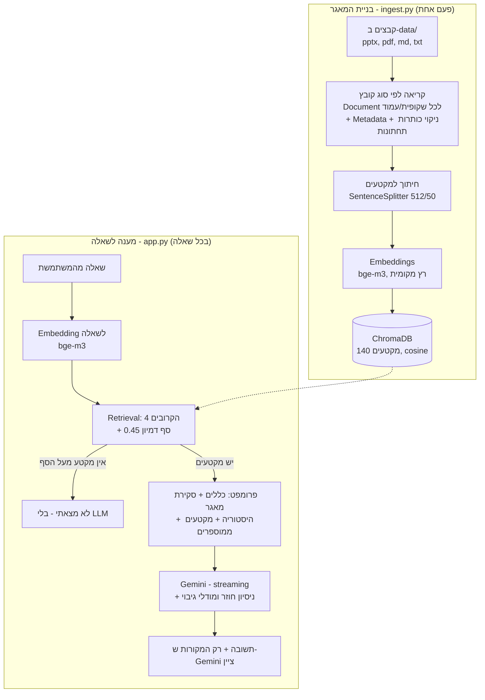

# StudyBot – עוזרת לימוד מבוססת RAG

StudyBot עונה על שאלות בשפה טבעית מתוך חומרי הלימוד של הקורס: מצגות בבינה מלאכותית וסיכומים בשפות תכנות. כל תשובה מגיעה עם המקורות שלה, כולל מספר השקופית או העמוד, ושאלה שאין לה תשובה בחומר מקבלת "לא מצאתי" במקום תשובה מומצאת.

המערכת עובדת בעברית ובאנגלית, ושאלה בשפה אחת יכולה למצוא תשובה במסמך שכתוב בשפה השנייה.

---

## מה המערכת עושה

- **שאלה ותשובה** מתוך מאגר של 7 קבצים: 2 מצגות PowerPoint, 2 קובצי PDF, 3 קובצי טקסט/Markdown.
- **הצגת מקורות:** קובץ, שקופית או עמוד, וציון דמיון. מוצגים רק המקורות שהתשובה באמת השתמשה בהם.
- **"לא מצאתי":** כשאין מקטע רלוונטי, המערכת עונה מיד בלי לפנות למודל השפה.
- **היסטוריית שיחה:** שאלות המשך ("ותני דוגמה") מובנות בהקשר. כפתור "שיחה חדשה" מאפס.
- **ממשק Streamlit** בעיצוב "מחברת", עם שאלות לדוגמה, תשובה שנכתבת בזמן אמת (streaming), ומקורות כפתקיות בצבע הנושא.

---

## ארכיטקטורה

המערכת בנויה משני תהליכים נפרדים: **בניית המאגר** (רץ פעם אחת) ו**מענה לשאלה** (רץ בכל שאלה).



### מבנה הפרויקט

```
פרויקט/
├── data/
│   ├── ai_theory/          מצגות הקורס (pptx)
│   └── programming/        חומרי תכנות (md, pdf, txt)
├── src/
│   ├── config.py           כל ההגדרות במקום אחד + תיקון SSL
│   ├── ingest.py           בניית המאגר: קריאה, חיתוך, Embeddings, שמירה
│   ├── app.py              ממשק Streamlit: אחזור, יצירת תשובה, מקורות
│   ├── query.py            ממשק שאלות בטרמינל (לבדיקות)
│   ├── ui_style.py         חלקי ה-HTML של העיצוב
│   ├── style.css           העיצוב (CSS) - מופרד מהלוגיקה
│   ├── list_models.py      כלי עזר: אילו מודלי Gemini זמינים למפתח
│   └── static/fonts/       גופנים מקומיים
├── chroma_db/              מסד הווקטורים (נוצר ע"י ingest.py)
├── .streamlit/config.toml  ערכת צבעים והגדרות שרת
├── requirements.txt
└── .env                    מפתח ה-API (לא עולה ל-Git)
```

### בחירות טכנולוגיות

| רכיב | בחירה | למה |
| --- | --- | --- |
| שפה | Python 3.13 | דרישת התרגיל |
| RAG | LlamaIndex | דרישת התרגיל. מטפלת בחיתוך, ב-Embeddings ובחיבור ל-Vector Store |
| Embeddings | `BAAI/bge-m3` (HuggingFace) | רב-לשוני: עברית ואנגלית באותו מרחב וקטורי. רץ מקומית ובחינם |
| Vector Store | ChromaDB | נשמר כתיקייה על הדיסק, לא דורש שרת, תומך בדמיון קוסינוס וב-Metadata |
| LLM | Gemini (`gemini-3.8-flash` + מודלי גיבוי) | שכבה חינמית, עברית טובה, חיבור מוכן ב-LlamaIndex |
| ממשק | Streamlit | צ'אט מוכן (`st.chat_message`), מתאים לפרויקט Python |
| קריאת מצגות | `python-pptx` (קורא שכתבנו) | שקופית = Document, כך שהמקור מצביע על שקופית מדויקת. הקורא המובנה של LlamaIndex מוריד מודל תמונות כבד שלא צריך |
| קריאת PDF | `pypdf` | עמוד = Document, עם מספר עמוד |

### פרמטרים עיקריים (`src/config.py`)

| פרמטר | ערך | הסבר |
| --- | --- | --- |
| `CHUNK_SIZE` / `CHUNK_OVERLAP` | 512 / 50 טוקנים | רוב השקופיות קצרות ונשארות שלמות. החפיפה שומרת על רעיון שנחתך |
| `TOP_K` | 4 | כמה מקטעים לשלוף לכל שאלה |
| `SIMILARITY_CUTOFF` | 0.45 | מסננת גסה בלבד. 0.6 חסם שאלות בעברית על שקופיות באנגלית; את הסינון העדין עושה Gemini (שורת SOURCES) |
| `THINKING_LEVEL` | LOW | פחות "חשיבה" של Gemini = תשובה מהירה יותר |
| `MAX_HISTORY_MESSAGES` | 6 | כמה הודעות קודמות נשלחות כהקשר |

---

## התקנה והרצה (Windows)

**1. סביבה וספריות** (מתיקיית הפרויקט):

```
python -m venv .venv
.venv\Scripts\python.exe -m pip install -r requirements.txt
```

> אם הפקודה `python` פותחת את Microsoft Store, יוצרים את הסביבה דרך VS Code: Python: Create Environment → Venv.

**2. מפתח API:** יוצרים מפתח ב-[Google AI Studio](https://aistudio.google.com/apikey) ומדביקים בקובץ `.env`:

```
GOOGLE_API_KEY=המפתח_שלך
```

**3. בניית המאגר** (פעם אחת, ושוב רק כשמשנים מסמכים). בהרצה הראשונה יורד מודל ה-Embeddings, כ-2.3GB:

```
.venv\Scripts\python.exe src\ingest.py
```

**4. הפעלת הממשק:**

```
.venv\Scripts\python.exe -m streamlit run src\app.py
```

הדפדפן ייפתח בכתובת `http://localhost:8501`.

**בדיקה מהטרמינל, בלי ממשק:** `.venv\Scripts\python.exe src\query.py`


---

## דוגמאות: 5 שאלות, תשובות ומקורות

| # | שאלה | תשובה (בקיצור) | מקור מוביל (דמיון) |
| --- | --- | --- | --- |
| 1 | what is the difference list-tuple? | List is mutable and written with `[]`; tuple is immutable, written with `()`, slightly faster, saves memory and can be a dict key. | python_basics.md (0.66) |
| 2 | מה ההבדל בין רשימה לטאפל? | רשימה ניתנת לשינוי ונכתבת בסוגריים מרובעים; טאפל אינו ניתן לשינוי ונכתב בסוגריים עגולים. טאפל מהיר מעט יותר, חוסך זיכרון ומתאים לנתונים קבועים. | python_basics.md (0.67) |
| 3 | What is the difference between machine learning and deep learning? | The key difference is who finds the features: in ML a person designs them, in DL the model learns them from raw data. Also: data size, hardware, interpretability. | Lecture1, שקופית 44 (0.75) + שקופית 45 (0.68) |
| 4 | מה זה Docker? | **"לא מצאתי את התשובה בחומר הלימוד."** | אין: הציון הגבוה ביותר 0.57, מתחת לסף |
| 5 | מה ההבדל בין abstract class ל-interface ב-Java? | מחלקה יורשת ממחלקה מופשטת אחת בלבד אך מממשת ממשקים רבים; למחלקה מופשטת יש שדות ובנאי ולממשק לא; מחלקה מופשטת ל"הוא סוג של", ממשק להגדרת יכולת. | java_oop.pdf, עמוד 4 (0.69) |

**מה הדוגמאות מראות:**
- שאלה 1 נשאלה באנגלית ונענתה מקובץ בעברית: האחזור הרב-לשוני עובד.
- שאלה 4 היא השאלה שאין לה תשובה במאגר. Gemini יודע מה זה Docker, ובכל זאת לא ענה מהידע הכללי שלו.
- שאלה 5 נענתה נכון מ-PDF בעברית שהטקסט שחולץ ממנו משובש (סוגריים הפוכים, סדר מילים).

---

## בעיות שנתקלנו בהן ואיך פתרנו

### 1. מקורות לא רלוונטיים, ותמיד 4 מקורות
**הבעיה:** המערכת שלפה תמיד 4 מקטעים. בשאלה על list/tuple הוצגו גם שקופיות על Machine Learning (0.58), רק כי מופיעה בהן המילה "difference". בשאלה על ML מול DL כל 4 המקורות קיבלו 0.65–0.75, אף ששניים לא רלוונטיים, כך שסף לבדו לא מפריד.
**הפתרון, בשני שלבים:**
1. **סף דמיון:** מקטע מתחת לסף לא נשלח ל-LLM. אם לא נשאר אף מקטע, עונים "לא מצאתי" בלי לפנות ל-Gemini (חוסך זמן ובקשות). בהתחלה קבענו 0.6, אבל הוא חסם שאלות לגיטימיות: "מה זה רשת נוירונים?" (בעברית, על שקופית באנגלית) קיבלה "לא מצאתי". הורדנו ל-0.45, והסף נשאר רק מסננת גסה. המדידה הראתה למה סף לא יכול להכריע לבד: "מה זה רשת נוירונים?" (יש חומר) קיבלה 0.52–0.54, ו"מה זה דוקר?" (אין חומר) קיבלה 0.50–0.51. פער של 0.03 בלבד. שתיהן עוברות את הסף, ו-Gemini הכריע נכון: ענה על הראשונה מתוך שקופיות 46–47, ועל השנייה ענה "לא מצאתי".
2. **Gemini מצטט את עצמו:** המקטעים נשלחים ממוספרים, ו-Gemini מתבקש לסיים בשורה `SOURCES: 1, 3`. הקוד מוחק את השורה ומציג רק את המקורות האלה.

### 2. רעש בשקופיות שגרם לתשובה חלקית
**הבעיה:** בכל שקופית חזרה כותרת תחתונה ("Machine Learning · Course 5777 · ...") ומספר שקופית. הרעש נכנס ל-118 מקטעים, בזבז טוקנים ומשך את השקופיות לשאלות כמו "מה אתה יודע ללמד?". התשובה דיברה רק על קורס ה-ML והתעלמה מחומרי התכנות.
**הפתרון:** ב-`ingest.py`, שורה שחוזרת ביותר מ-30% מהשקופיות נמחקת, וכך גם שורה שהיא רק מספר. בנוסף, רשימת הקורסים והקבצים שבמאגר (מתוך ה-Metadata) נכנסת לפרומפט, כדי ששאלות על המאגר כולו יקבלו תשובה מלאה ולא רק מ-4 מקטעים.

### 3. שגיאת SSL בהורדת המודל (סינון רשת)
**הבעיה:** `CERTIFICATE_VERIFY_FAILED: CA cert does not include key usage extension`. סינון הרשת מחליף את אישור האבטחה של אתרים באישור משלו. Windows סומך עליו, אבל Python 3.13 בודק אישורים בקפדנות ודחה אותו.
**הפתרון:** הספרייה `truststore` ושתי שורות בראש `config.py`, כך ש-Python משתמש במאגר האישורים של Windows. הרמז: `pip` עבד, כי הוא כבר משתמש ב-`truststore`.

### 4. הורדה כפולה של המודל (2.27GB מיותרים)
**הבעיה:** אחרי הורדת `pytorch_model.bin`, ספריית transformers התחילה להוריד את אותו מודל שוב בפורמט `safetensors`.
**הפתרון:** מצאנו בקוד המקור של transformers את המשתנה `DISABLE_SAFETENSORS_CONVERSION` והפעלנו אותו ב-`config.py`. פתרון ראשון (מצב offline לפי תיקיית המטמון) נכשל, כי LlamaIndex שומרת מודלים בתיקייה אחרת מזו שבדקנו.

### 5. מכסה ועומס ב-Gemini (שגיאות 429 ו-503)
**הבעיה:** בשכבה החינמית יש 20 בקשות ביום לכל מודל, והבדיקות ניצלו אותן. בנוסף, Gemini החזיר מדי פעם 503 (עומס). אחרי המעבר ל-streaming, הניסיון החוזר האוטומטי של `llm.chat` כבר לא פעל.
**הפתרון:** `ask_gemini()` מבדילה בין השגיאות. ב-503 היא מחכה ומנסה שוב, עם המתנה שגדלה בכל ניסיון. ב-429 היא מסמנת את המודל ועוברת מיד למודל גיבוי, שיש לו מכסה נפרדת. שמות מודלי הגיבוי נלקחו מ-`list_models.py`, אחרי ששם שניחשנו התברר כלא קיים.

### 6. תשובות איטיות
**הבעיה:** כל תשובה לקחה הרבה זמן, ועד שהיא הסתיימה ראו רק ספינר.
**הפתרון:** רמת "חשיבה" נמוכה ל-Gemini (`LOW`; הערך `MINIMAL` נדחה עם שגיאה 400), ו-streaming שמציג את התשובה תוך כדי כתיבה. אחרי שהמודלים העמוסים סומנו, תשובות הגיעו תוך 3–4.5 שניות.

---

## בונוס: השוואה בין שתי אסטרטגיות Chunking

**השיטה:** 15 שאלות בעברית ובאנגלית, שלכל אחת ידוע מראש המקור הנכון: קובץ, ולפעמים גם שקופית או עמוד (`tests/eval_questions.json`). לכל אסטרטגיה בונים אינדקס בזיכרון ובודקים אם המקטע הנכון נשלף. ההשוואה משתמשת רק ב-Embeddings המקומיים, בלי Gemini, ולכן לא צורכת מכסה. הרצה: `.venv\Scripts\python.exe tests\evaluate_chunking.py`.

| אסטרטגיה | מקטעים | מילים למקטע | Hit@1 | Hit@4 | MRR | מילים שנשלחות ל-LLM | זמן בנייה (שניות) |
| --- | --- | --- | --- | --- | --- | --- | --- |
| A: מקטעים גדולים (512/50) | 140 | 85 | 12/15 (80%) | 14/15 (93%) | 0.85 | 425 | 94 |
| B: מקטעים קטנים (128/20) | 275 | 46 | 12/15 (80%) | 14/15 (93%) | 0.87 | 223 | 116 |

- **Hit@1:** המקטע הראשון שנשלף הוא מהמקור הנכון. **Hit@4:** המקור הנכון נמצא בין 4 המקטעים שנשלחים ל-LLM. **MRR:** ממוצע של 1 חלקי המיקום של המקור הנכון.

**מסקנות:**
1. **הדיוק זהה.** רוב השקופיות קצרות מ-128 טוקנים, ולכן שתי האסטרטגיות חותכות אותן כמעט באותה צורה. ההבדל מורגש בקבצים הארוכים (Markdown ו-txt).
2. **B שולחת חצי מהמילים ל-LLM** (223 לעומת 425), כלומר חצי עלות בטוקנים, בתמורה לפי 2 מקטעים וזמן בנייה ארוך יותר.
3. **השארנו את A.** המגבלה שלנו בשכבה החינמית היא **מספר הבקשות** ביום, ולא מספר הטוקנים, כך שהחיסכון של B לא עוזר לנו. A נותנת ל-Gemini שקופית שלמה בכל מקטע, והמדד שלנו לא בודק את שלמות התשובה. במערכת שמשלמת לפי טוקן, B הייתה הבחירה.
4. **השאלה שנכשלה בשתיהן:** "מה זה קצב הלמידה אלפא?" שלפה שקופיות על למידה מהרצאה 1, ולא את שקופיות 14 ו-16 בהרצאה 2. בשקופיות המונח מופיע כ-"α" ובאנגלית, והמונח העברי "קצב למידה" התחבר למילה "למידה" הכללית. זו מגבלה של אחזור בין שפות במונחים מקצועיים, ולא של שיטת החיתוך.
5. **לקח על הערכה:** בהרצה הראשונה יצא 87% ב-Hit@4. התברר ששתי תשובות צפויות במפתח היו שגויות: LEFT JOIN נמצא בעמוד 3 ולא בעמוד 2, ו-α מוסבר גם בשקופית 14. תיקון המפתח העלה את התוצאה ל-93%. כשמעריכים מערכת, צריך לבדוק גם את מפתח התשובות.

---

## מגבלות ידועות

- **PDF בעברית:** חילוץ הטקסט משבש סוגריים וסדר מילים. האחזור והתשובה עדיין נכונים, ולכן לא השקענו בתיקון.
- **טקסט בתוך תמונות** בשקופיות לא נקרא.
- **מכסה חינמית:** 20 בקשות ביום לכל מודל Gemini.
